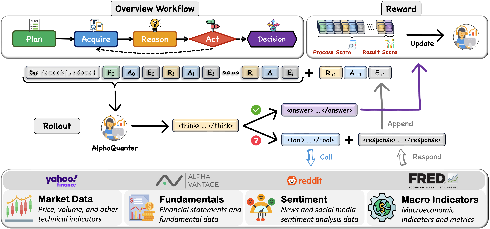
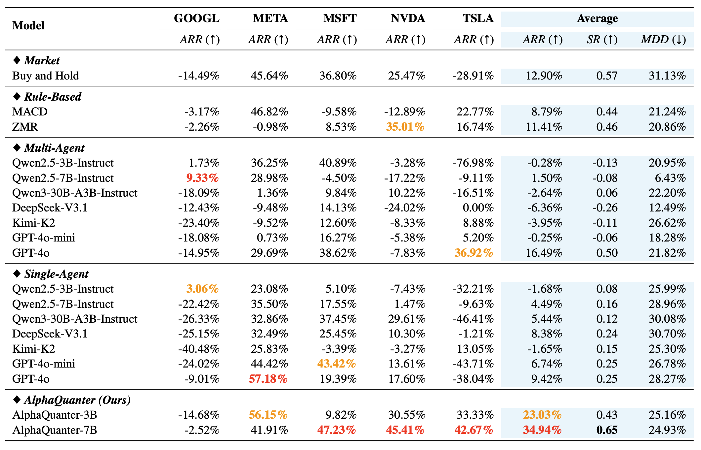
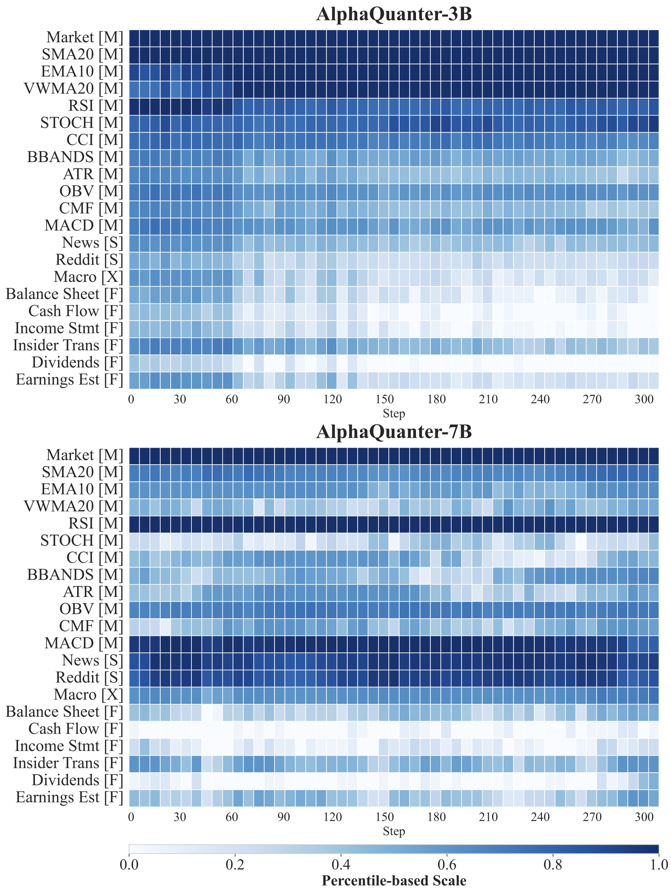

# AlphaQuanter

This repository contains the implementation of the paper [AlphaQuanter: An End-to-End Tool-Orchestrated Agentic Reinforcement Learning Framework for Stock Trading](https://www.arxiv.org/pdf/2510.14264).

---

## 📖 Overview



While Large Language Model (LLM) agents show promise in automated trading, they still face critical limitations. Prominent multi-agent frameworks often suffer from inefficiency, produce inconsistent signals, and lack the end-to-end optimization required to learn a coherent strategy from market feedback. 

**AlphaQuanter** addresses these challenges with a single-agent framework that uses reinforcement learning (RL) to learn a dynamic policy over a transparent, tool-augmented decision workflow. This empowers a single agent to autonomously orchestrate tools and proactively acquire information on demand, establishing a transparent and auditable reasoning process.

### Key Features

- 🎯 **Single-Agent Architecture**: More efficient than multi-agent frameworks
- 🔧 **Tool-Orchestrated**: Dynamic tool selection for information acquisition
- 🧠 **End-to-End RL Training**: Learns coherent strategies from market feedback
- 📊 **State-of-the-Art Performance**: Superior returns and risk management
- 🔍 **Interpretable Reasoning**: Transparent decision-making process

---

## 🏗️ Project Structure

```
AlphaQuanter/
├── data_collection/          # Data acquisition scripts
└── verl/                     # Training scripts (RL framework)
```

---

## 🚀 Quick Start

### 1. Data Collection

Use scripts in `data_collection/` to gather comprehensive market data:

```bash
cd data_collection
bash collect_data.sh
```

See `data_collection/README.md` for detailed usage.

### 2. Training

Use the modified verl framework in `verl/` for reinforcement learning training:

```bash
cd verl
python recipe/langgraph_agent/stock_trading/convert_to_pkl.py
bash recipe/langgraph_agent/stock_trading/run.sh
```

See `verl/README.md` for detailed training instructions.

---

## 📊 Key Results

### Evaluation on 5 Stocks




AlphaQuanter achieves state-of-the-art performance compared to existing baselines:

**Key Observations:**
- ✅ Single-agent framework is superior to multi-agent frameworks
- ✅ Prompt-based reasoning alone is insufficient for trading
- ✅ End-to-end RL optimization significantly outperforms all baselines

### Tool Usage Patterns

<div align="center">
  
</div>

The agent actively learns and refines information-seeking policies:

- **7B Model**: Develops focused and selective strategy, prioritizing key technical indicators
- **Expert-like Heuristic**: Prioritizes trend and volume data, using sentiment/macro as secondary signals
- **Dynamic Strategy**: Proves strategies are dynamic, not static

---

## 🛠️ Technical Details

### Data Sources
- **Market Data**: Historical OHLCV from Yahoo Finance and 15+ indicators via Alpha Vantage
- **Sentiment Data**: News articles and Reddit posts
- **Fundamental Data**: Financial statements, dividends, insider transactions
- **Macroeconomic Data**: Treasury yields, Fed rates, CPI, commodities

### Training Framework
- Modified PPO trainer with backtesting capabilities based on verl
- Tool-orchestrated decision workflow
- End-to-end reinforcement learning optimization

---

## 📝 Citation

```bibtex
@misc{deng2025alphaquanterendtoendtoolorchestratedagentic,
      title={AlphaQuanter: An End-to-End Tool-Orchestrated Agentic Reinforcement Learning Framework for Stock Trading}, 
      author={Zheye Deng and Jiashu Wang},
      year={2025},
      eprint={2510.14264},
      archivePrefix={arXiv},
      primaryClass={cs.CE},
      url={https://arxiv.org/abs/2510.14264}, 
}
```